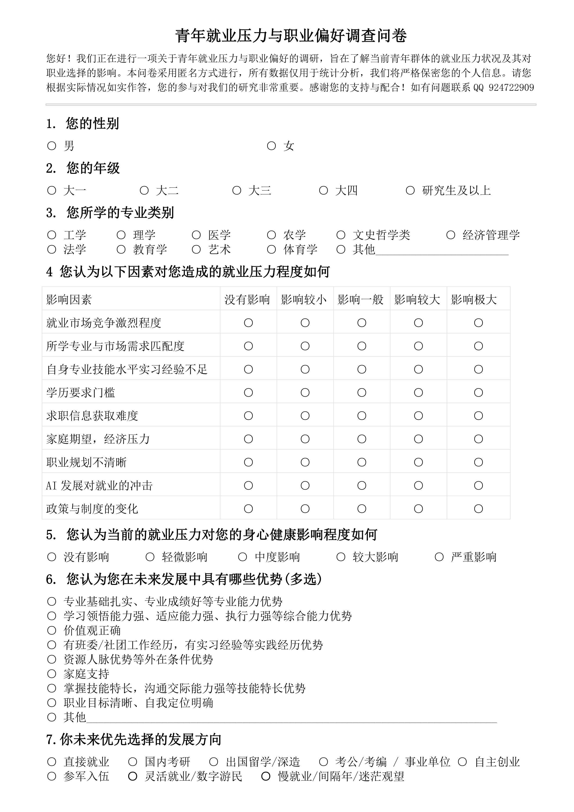
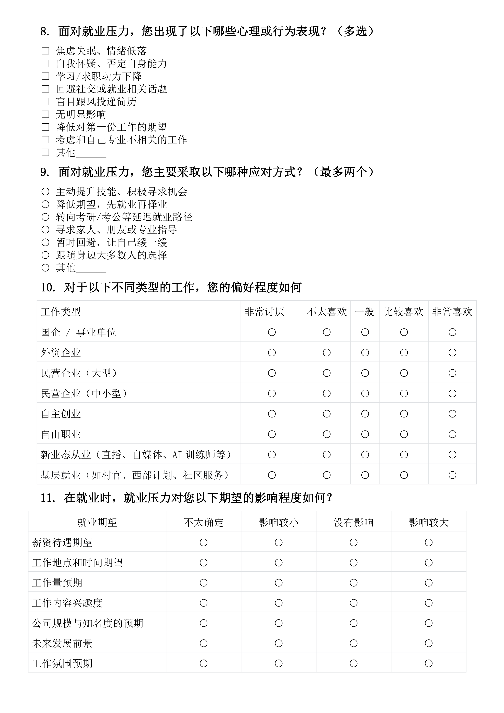

 # Decomposing Perceived Employment Stress and Career Preferences Across Academic Grades: Evidence from a Two-Batch Survey of University Students

This repository hosts the survey datasets, questionnaire documentation, and analytical resources accompanying the research article:

> **Decomposing Perceived Employment Stress and Career Preferences Across Academic Grades: Evidence from a Two-Batch Survey of University Students**  
> Yunfu Ma, Lele Shen, Zongyi Lv, Yang Meng, Qiuxiang Bian, and Jun Wang*  
> *School of Science, Jiangsu University of Science and Technology, Zhenjiang 212003, China*  
> \*Corresponding author: `jwang77@just.edu.cn`

**Data use.** The survey data may be used only for non-commercial student academic research. They may not be used as a source for commercial reports, consulting firms, or any other purpose without prior written authorisation from the authors. See [LICENSE.md](LICENSE.md). Analysis code under `Code/` remains under the MIT License in `Code/LICENSE` and that licence does not cover the data.

---

## 1. Overview and Research Objectives

Youth employment pressure has intensified amid rapid expansion of higher education, structural mismatches between talent supply and labor-market demand, and ongoing digital-economic transformation. Although recent surveys document a dual trend among university students—a strong concentration in stable, high-threshold organizational careers alongside a growing uptake of flexible or delayed pathways—existing empirical studies rarely explain why students facing seemingly similar pressures diverge toward opposite career tracks.

Here is our Questionaire.

This study addresses three common methodological limitations in the literature:

1. **Unidimensional aggregation of stressors:** Collapsing diverse employment stressors into a single composite index without testing whether distinct stress facets steer students toward opposing career routes.
2. **Confounded cross-grade comparisons:** Failing to separate developmental grade progression from severe grade–discipline collinearity, or failing to distinguish changes in total stress intensity from shifts in stress composition and choice-set breadth.
3. **Single-level operationalization of career preference:** Relying on a single measurement level without accounting for acquiescence response style (uniform scale inflation) on Likert rating scales or testing whether conclusions hold across attitude, nominal, and expectation levels.

Using a two-batch survey of Chinese university students ($N = 1,579$; main sample $N = 1,026$, independent replication batch $N = 553$), we organize the investigation around three research questions:
- **RQ1 (Structure and Replication):** What is the underlying dimensional structure of perceived employment stress, how are students' workplace preferences and psychological–behavioral responses organized, and does this ranking structure replicate across independent survey batches?
- **RQ2 (Grade Differences):** Once grade–discipline collinearity and demographic confounders are controlled, how do the overall level and dimensional composition of employment stress, as well as first-choice destinations and the breadth of the acceptable career choice set, vary across academic grades?
- **RQ3 (Multi-Level Associations and Mechanisms):** How is perceived employment stress associated with career preferences across attitude, nominal, and expectation levels once rating-scale response bias is removed, and do distinct stress dimensions steer students toward opposite career pathways?

---

## 2. Summary of Key Findings

1. **Two-Dimensional Structure of Employment Stress (RQ1):**
   Polychoric exploratory factor analysis (EFA) with Horn's parallel analysis partitions the nine employment stressors into two correlated ($\Phi = 0.750$) yet functionally distinct dimensions:
   - **F1: Situational–Planning (Uncertainty) Stress** (5 items: family expectations and financial pressure, unclear career planning, policy and institutional change, job-search information asymmetry, and AI disruption).
   - **F2: Competition–Human Capital (Externally Evaluated) Stress** (4 items: major–market fit, overall labor-market competition, skill and internship shortfalls, and academic degree thresholds).
2. **Organizational Security Over Public Ownership Per Se (RQ1):**
   Workplace preferences form a leading tier of three large-organization employers—state-owned enterprises (SOEs)/public institutions, foreign firms, and large private firms (all scoring $> 3.58$ on a 5-point scale)—separated by a sharp drop from small/medium private enterprises, grassroots posts, and flexible routes. Students prioritize **organizational employment security** rather than public-sector ownership alone. Relative stressor and preference hierarchies replicate strongly across batches (Spearman's $\rho = 0.883$ and $\rho = 0.952$).
3. **Stress Composition Shifts and Choice-Set Narrowing Across Grades (RQ2):**
   Academic grade and discipline are strongly collinear (Cramér's $V = 0.431$). Controlling for discipline, gender, and survey mode eliminates the apparent grade trend in overall stress ($\beta = 0.025, p = .282$) but reveals a shift in **stress composition**: `F2` (competition–human capital stress) rises significantly across grades ($\beta = +0.069, p = .041$ main; $\beta = +0.079, p = .0005$ pooled), whereas `F1` remains flat. Concurrently, the acceptable career choice set narrows progressively from Year 1 ($84.0\%$ single-path commitment) to Year 4 ($97.8\%$).
4. **Acquiescence Bias and Dimensional Double Dissociation (RQ3):**
   - **Attitude Level (Q10):** Uncentered ordered-logit models suggest that overall stress positively predicts 7 of 9 workplace preferences ($\text{OR} = 1.040\text{--}1.380$). However, within-person Q10 baseline ratings rise by $+0.302$ points across stress quintiles, accounting for $\sim 69\%$ of the raw increase in within-system preference. After within-person (ipsative) centering, 8 of 9 associations become null, leaving only a negative association with self-employment ($\beta = -0.070$).
   - **Nominal Level (Q7):** Forced-choice multinomial logit models confirm a null effect of composite stress on primary career direction ($\text{RRR} = 1.003, p_{\mathrm{BH}} = .978$ for within-system employment).
   - **Dimensional Divergence:** Entering `F1` and `F2` simultaneously uncovers opposing directional pulls masked by the composite score: `F2` channels students toward established organizations (foreign firms $\Delta\text{logit} = -0.399, p_{\mathrm{BH}} = .002$; large private firms $\Delta\text{logit} = -0.319, p_{\mathrm{BH}} = .016$) and postgraduate study ($\text{RRR} = 1.331$), whereas `F1` increases openness to grassroots employment ($\Delta\text{logit} = +0.406, p_{\mathrm{BH}} = .002$) and flexible routes.
   - **Expectation Level (Q11):** Stressed students concede selectively on negotiable transactional terms (salary, geographic location, working hours) while defending employer size and reputation. Expectation adjustment partially mediates positive links to large organizations ($9.5\%\text{--}12.6\%$) but exerts an inconsistent mediation (suppression) effect on grassroots employment ($a \cdot b = -0.0133$ vs. direct path $c' = +0.1099$).

---

## 3. Dataset Structure and Sample Composition

Data were collected in two independent survey batches totaling $N = 1,579$ valid responses:

| Characteristic     | Category                                 | Main Sample ($N = 1,026$) | Second Batch ($N = 553$) | Pooled Sample ($N = 1,579$) |
| :----------------- | :--------------------------------------- | :-----------------------: | :----------------------: | :-------------------------: |
| **Survey Timing**  | Administration window                    |         May–June          |        September         |          Combined           |
| **Mode**           | Paper questionnaire                      |        779 (75.9%)        |       553 (100.0%)       |        1,332 (84.4%)        |
|                    | Online (Wenjuanxing)                     |        247 (24.1%)        |         0 (0.0%)         |         247 (15.6%)         |
| **Gender**         | Male                                     |        603 (58.8%)        |       387 (70.0%)        |         990 (62.7%)         |
|                    | Female                                   |        423 (41.2%)        |       166 (30.0%)        |         589 (37.3%)         |
| **Academic Grade** | First year (Undergraduate)               |        431 (42.0%)        |         3 (0.5%)         |         434 (27.5%)         |
|                    | Second year (Undergraduate)              |        158 (15.4%)        |       383 (69.3%)        |         541 (34.3%)         |
|                    | Third year (Undergraduate)               |        348 (33.9%)        |         3 (0.5%)         |         351 (22.2%)         |
|                    | Fourth year (Undergraduate)              |         45 (4.4%)         |         0 (0.0%)         |          45 (2.8%)          |
|                    | Graduate (Postgraduate)                  |         44 (4.3%)         |       164 (29.7%)        |         208 (13.2%)         |
| **Discipline**     | Engineering                              |        483 (47.1%)        |       521 (94.2%)        |        1,004 (63.6%)        |
|                    | Science                                  |        276 (26.9%)        |        29 (5.2%)         |         305 (19.3%)         |
|                    | Economics / Management                   |        109 (10.6%)        |         0 (0.0%)         |         109 (6.9%)          |
|                    | Humanities / Philosophy / Arts           |         77 (7.5%)         |         0 (0.0%)         |          77 (4.9%)          |
|                    | Other (Medicine, Agriculture, Law, etc.) |         81 (7.9%)         |         3 (0.5%)         |          84 (5.3%)          |

### Sample Assignment Rules
- **Main Sample ($N = 1,026$):** Primary dataset for descriptive hierarchies, EFA dimensionality (RQ1), and covariate-adjusted cross-grade models (RQ2), as it covers all five academic grades and disciplinary groups.
- **Second Batch ($N = 553$):** Independent replication dataset for cross-batch ranking concordance (RQ1).
- **Pooled Sample ($N = 1,579$):** Primary dataset for inferential multi-level stress–preference regressions, dimensional contrasts, mediation, and moderation analyses (RQ3), validated via three-stage nested pooling eligibility tests ($\text{M0} \rightarrow \text{M1} \rightarrow \text{M2}$). Because the $[\text{Batch} = 1, \text{Mode} = \text{Online}]$ cell is a structural zero, source cells are exhaustively parameterized by two binary indicators (`batch` and `mode`) without an interaction term.

---

## 4. Survey Instrument and Variable Codebook (Q1–Q11)

The survey instrument consists of 11 question blocks organized around a four-part funnel design:

| Block   | Construct                                       | Items / Options                                              | Coding & Scale                                               | Analytical Role                                              |
| :------ | :---------------------------------------------- | :----------------------------------------------------------- | :----------------------------------------------------------- | :----------------------------------------------------------- |
| **Q1**  | Gender                                          | Male, Female                                                 | Binary / Nominal                                             | Covariate control; subgroup moderation                       |
| **Q2**  | Academic grade                                  | Year 1, Year 2, Year 3, Year 4, Graduate                     | Ordinal (1–5)                                                | Focal predictor in RQ2; covariate/moderator in RQ3           |
| **Q3**  | Academic discipline                             | 11 raw categories collapsed into 5 analytical groups (Engineering, Science, Economics/Management, Humanities/Arts, Other) | Nominal (5 categories)                                       | Collinearity check; covariate control; moderation            |
| **Q4**  | Perceived employment stressors                  | `Q4_1` Market competition `Q4_2` Major–market fit `Q4_3` Skill & internship shortfalls `Q4_4` Academic degree thresholds `Q4_5` Job-search information asymmetry `Q4_6` Family expectations & finances `Q4_7` Unclear career planning `Q4_8` AI disruption `Q4_9` Policy & institutional change | 5-point Likert (`1` = no stress to `5` = extreme stress)     | **Overall stressor index:** unweighted mean of `Q4_1`–`Q4_9` **F1 (Situational–Planning):** `Q4_5`, `Q4_6`, `Q4_7`, `Q4_8`, `Q4_9` **F2 (Competition–Human Capital):** `Q4_1`, `Q4_2`, `Q4_3`, `Q4_4` |
| **Q5**  | Perceived health impact                         | Impact of employment stress on physical and mental health    | 5-point Ordinal (`1` = no impact to `5` = severe impact)     | Supplementary severity outcome in RQ2 & pooling tests        |
| **Q6**  | Self-perceived employability strengths          | 9-option multiple-response checklist (values, learning ability, major knowledge, internship experience, skills, networks, etc.) | Binary (`0`/`1` per option); sum count (`0`–`9`)             | RQ1 descriptives (Wilson 95% CIs); total count used as covariate in RQ3 |
| **Q7**  | Intended post-graduation career direction       | 8 options: postgraduate study, study abroad, civil service, military service, enterprise employment, entrepreneurship, flexible employment, delayed employment | **Single-choice scheme (4 mutually exclusive categories):** 1. *Further education* ($n=823$) 2. *Direct employment* ($n=579$) 3. *Within-system employment* ($n=133$) 4. *Undecided* ($n=44$) **Multiple-choice (choice-set) scheme:** binary indicators & total paths selected | RQ1 fallback ratio; RQ2 choice-set narrowing; RQ3 nominal-level outcome |
| **Q8**  | Psychological & behavioral stress reactions     | 9-option checklist (anxiety, self-doubt, sleep disturbance, mass applications, lowering expectations, etc.) | Binary (`0`/`1` per option); sum count (`0`–`9`)             | RQ1 descriptives; total count used as covariate in RQ3       |
| **Q9**  | Primary coping strategies                       | 7-option checklist (at most 2 selections permitted)          | Binary (`0`/`1` per option)                                  | RQ1 descriptives; compliance sensitivity check               |
| **Q10** | Workplace-type preferences (Attitude level)     | `Q10_1` SOEs & public institutions (*within-system preference*) `Q10_2` Foreign firms `Q10_3` Large private firms `Q10_4` Small & medium-sized private enterprises (SMEs) `Q10_5` Self-employment `Q10_6` Freelancing `Q10_7` New-form employment `Q10_8` Grassroots positions | 5-point Likert (`1` = very low to `5` = very high) **Flexible/new-form index:** mean of `Q10_5`–`Q10_7` **Ipsative (within-person centered) score:** $Y_{ij}^{\text{ips}} = Y_{ij} - \bar{Y}_{i\cdot}$ | RQ1 hierarchy; RQ2 outcomes; RQ3 attitude-level outcomes (9 total) |
| **Q11** | Job-expectation adjustments (Expectation level) | 7 domains: salary, geographic location, working hours, job–major alignment, career development prospects, employer size & reputation, contract security | Ordinal (`0` = no impact, `1` = moderate, `2` = considerable; `99` = "not sure" recoded as `NaN`) **Expectation-change index:** mean across non-missing items ($n = 1,013$ main; $n = 1,554$ pooled) | RQ1 concession hierarchy; RQ2 outcome; RQ3 expectation-level outcome & mediator |

---

## 5. Analytical Pipeline and Reproducibility

| Research Question                    | Outcome Level                    | Statistical Methods                                          | Analytical Sample                                       |
| :----------------------------------- | :------------------------------- | :----------------------------------------------------------- | :------------------------------------------------------ |
| **RQ1: Structure & Replication**     | Descriptive / Latent structure   | Polychoric EFA (PAF + promax rotation) with Horn's parallel analysis (1,000 permutations); Cronbach's $\alpha$ and McDonald's $\omega$; tie-corrected Kendall's $W$; single- vs. multiple-choice comparison; cross-batch Spearman's $\rho$ and Cohen's $d$ | Main sample ($N = 1,026$) Replication ($N = 553$)    |
| **RQ2: Grade Differences**           | Continuous / Ordinal / Nominal   | Cramér's $V$ collinearity check; permutation Jonckheere–Terpstra trend test & Kendall's $\tau_b$; orthogonal polynomial contrasts (linear, quadratic, cubic); covariate-adjusted OLS (HC3 robust SEs); ordered & partial proportional-odds logit (with Brant test); multinomial logit | Main sample ($N = 1,026$) Robustness ($N = 1,579$)   |
| **RQ3: Stress $\rightarrow$ Choice** | Attitude / Nominal / Expectation | Covariate-adjusted ordered logit; within-person (ipsative) centering; dimensional Wald contrasts ($\beta_{\mathrm{F1}} - \beta_{\mathrm{F2}}$); multinomial logit with delta-method AMEs and IIA checks; 5,000-resample non-parametric bootstrap mediation; 27 grouped LR moderation tests with Benjamini–Hochberg FDR correction | Pooled sample ($N = 1,579$; $n = 1,554$ for Q11 models) |

### Software Environment
All analyses and figures were produced in **Python** with the random number generator seed fixed at `42`:
- `statsmodels` `0.15.0`
- `factor_analyzer` `0.5.1`
- `numpy`, `scipy`, `pandas`, `matplotlib`

---

## 6. Funding and Ethics Declarations

- **Funding:** Supported by the Undergraduate Innovation and Entrepreneurship Training Program Project (Grant No. `X2026102890012`).
- **Ethics Statement:** All survey procedures involving human participants were conducted in accordance with institutional ethical standards and the 1964 Helsinki Declaration and its later amendments. Participation was voluntary and anonymous, with informed consent obtained from all participants prior to completion.

---

## 7. License

Two licences apply, and they do not overlap:

- **Survey data, questionnaire scans, derived tables, and survey materials** are covered by the Academic Research Use Terms in [`LICENSE.md`](LICENSE.md). Permitted use is limited to non-commercial academic research by students (and to supervision of that research). Use as a data source for commercial reports, consulting firms, market-research products, or any other unauthorised purpose is prohibited.
- **Analysis source code** under `Code/` is covered only by the MIT License in [`Code/LICENSE`](Code/LICENSE). The MIT License does not license the data.

Questions about permission should be sent to the corresponding author before any use that is not expressly allowed.

---

## 8. Contact

For questions regarding the dataset, codebook, or replication scripts, please contact the corresponding author:
- **Dr. Jun Wang** — School of Science, Jiangsu University of Science and Technology (`jwang77@just.edu.cn`)